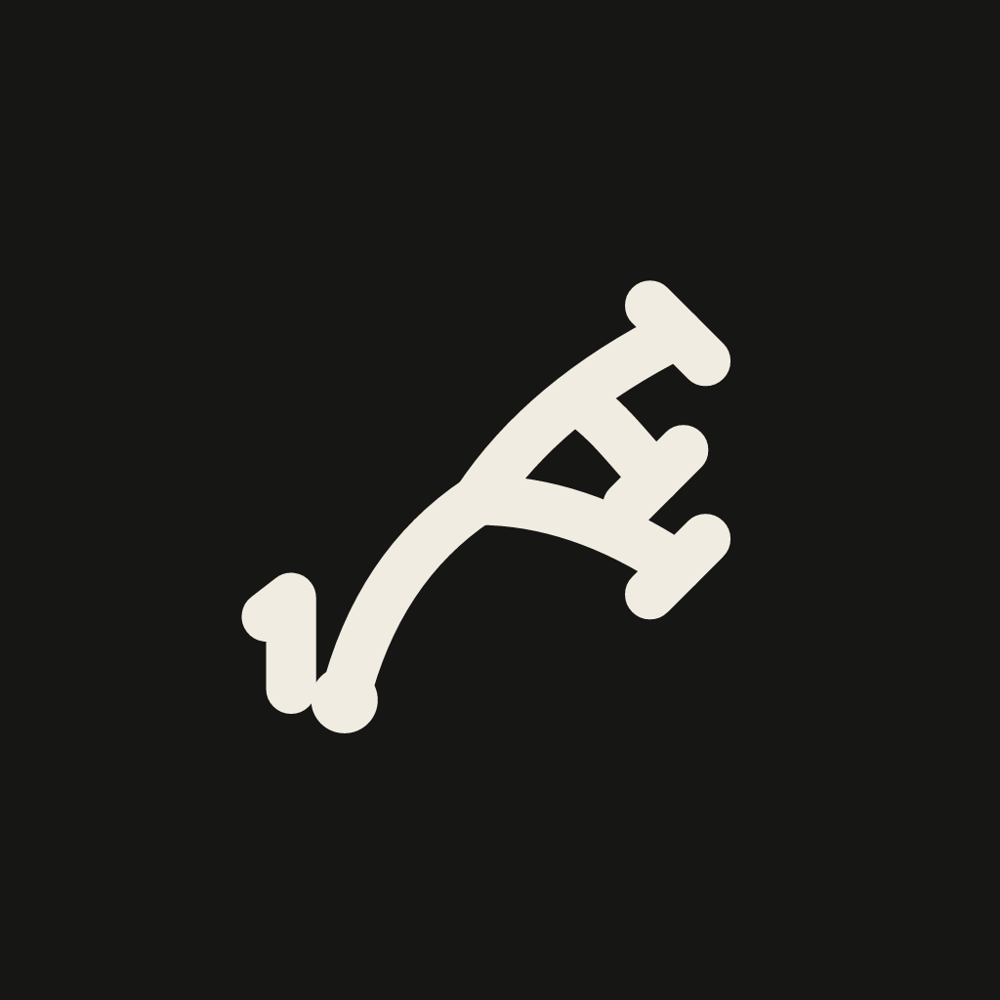
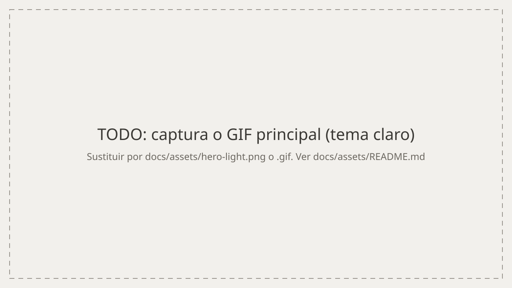
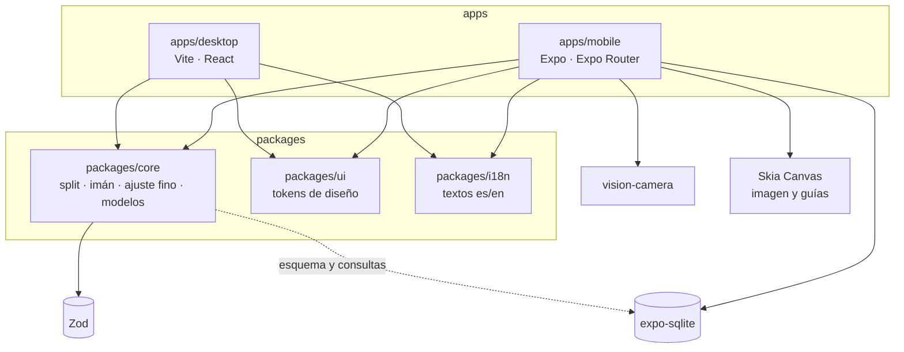

<div align="center">



# AR-Darwin

**Calca dibujos con la cámara del móvil. Sin anuncios.**

[](#-roadmap)
[](LICENSE)
[](https://github.com/mkcodev/ar-darwin/actions/workflows/ci.yml)
[](#-calidad)
<br>


[Demo](#-empezar) · [Documentación](docs/) · [Reportar un bug](https://github.com/mkcodev/ar-darwin/issues/new?template=bug.md)

</div>

<!-- TODO: URL de la demo (hoy no hay ninguna publicada). Sustituir el enlace "#demo" de arriba. -->
<!-- TODO: captura o GIF principal. Ver docs/assets/README.md -->
<div align="center">
  <picture>
    <source media="(prefers-color-scheme: dark)" srcset="docs/assets/hero-dark.svg">
    
  </picture>
</div>

<details>
<summary>🇬🇧 English summary</summary>

AR-Darwin is an ad-free Android app (Expo, React Native) for tracing drawings: it overlays an image on the camera feed, with a magnet mode for precise alignment, fine nudging, a touch lock, and a splitter that cuts large drawings into per-sheet tiles with progress tracking. Pure logic lives in a tested TypeScript package shared with a Vite desktop app (currently a design-system playground). The project is under active development; the code is MIT-licensed and the documentation is in Spanish.

</details>

## Contenido

- [¿Por qué existe?](#-por-qué-existe)
- [Funcionalidades](#-funcionalidades)
- [Stack](#-stack)
- [Arquitectura](#-arquitectura)
- [Decisiones técnicas](#-decisiones-técnicas)
- [Calidad](#-calidad)
- [Desarrollo con IA](#-desarrollo-con-ia)
- [Empezar](#-empezar)
- [Roadmap](#-roadmap)
- [Autor](#-autor)
- [Licencia](#-licencia)

> [!NOTE]
> El proyecto está en desarrollo. La app móvil (Android) es lo que funciona hoy; la app de escritorio es por ahora un *playground* del sistema de diseño. No hay versión publicada en tiendas.

## 🎯 ¿Por qué existe?

Las apps de AR drawing más populares viven de anuncios, se desalinean con el mínimo movimiento, no bloquean los toques accidentales y no ayudan con dibujos que no caben en un folio (según el análisis de producto en [`PRODUCT.md`](PRODUCT.md)). AR-Darwin busca lo contrario: cero anuncios, control preciso de la imagen y un divisor en trozos con progreso.

Es para quien empieza a dibujar, para quien hace murales o láminas grandes y para quien comparte su proceso en redes.

<!-- TODO: añadir 1-2 frases con tu motivación personal para crear el proyecto. -->

## ✨ Funcionalidades

Estado según [`docs/ROADMAP.md`](docs/ROADMAP.md) en `main`.

| Funcionalidad | Qué aporta |
| --- | --- |
| [x] Imagen superpuesta sobre la cámara | Arrastrar, pellizcar y rotar con gestos en el hilo de UI; opacidad con slider |
| [x] Bloqueo de toques | Pulsación larga de 1 s en el candado: la imagen no se mueve por un roce |
| [x] Modo imán | Guías en ejes y ángulos rectos, con vibración y histéresis |
| [x] Ajuste fino | Dos velocidades, pulsación larga y reset |
| [x] Espejo, linterna y ajustes de imagen | Espejo H/V, contraste, brillo e invertir con Skia |
| [x] Divisor en trozos | Manual o por folios (A4, A3, Carta) con ancho final en cm, con vista previa en vivo |
| [x] Progreso por trozo | Marcar trozos hechos, minimapa, botón «Siguiente trozo» y hoja «¡Dibujo terminado!» |
| [x] Biblioteca local | Proyectos en SQLite con categorías, miniaturas y estado «En curso · 4/9» |
| [x] Ajustes y onboarding | Tema, mano que dibuja, idioma (es/en) y tres pantallas de bienvenida |
| [ ] Ajustes extras | Vibración, opacidad y papel por defecto, créditos y licencias (PR [#108](https://github.com/mkcodev/ar-darwin/pull/108)) |
| [ ] Biblioteca 2 | «Seguir calcando» con mapa de trozos, búsqueda, filtros y orden |
| [ ] App de escritorio | Preparar imagen, mesa de luz y envío al móvil por QR (fase 2) |

## 🧱 Stack

| Grupo | Tecnología | Por qué |
| --- | --- | --- |
| **Frontend** | Expo 57 + Expo Router (development build) | App nativa con React; Expo Go no sirve por la cámara |
| | react-native-vision-camera 5 | Vista de cámara rápida |
| | @shopify/react-native-skia 2.6 | Imagen, guías y filtros dibujados en GPU |
| | Reanimated 4.5 + Gesture Handler | Gestos y muelles en el hilo de UI |
| | Vite 8 + React 19 + Motion 14 | La app de escritorio no necesita servidor |
| **Datos** | expo-sqlite | Biblioteca local de proyectos, sin cuenta |
| | Zod 4 | Modelos y datos importados validados |
| **Testing y CI** | Vitest 5 | La lógica pura se testea desde el primer día |
| | GitHub Actions | `typecheck`, `lint`, `test`, bundle de Metro y build web en cada PR |
| **Herramientas** | pnpm 11 + Turborepo 2 | Monorepo con caché de tareas |
| | TypeScript 6 (estricto) + Biome 2.5 | Tipos sin `any`; lint y formato en una sola herramienta |
| | EAS Build | APK de desarrollo y de prueba |

Backend: no hay. Todo es local; Supabase está previsto para la fase 3 (cuenta y sincronización).

## 🧭 Arquitectura

La lógica vive una vez en `packages/core` y la consumen la app móvil y la de escritorio.



```text
ar-darwin/
├─ apps/
│  ├─ mobile/     # Expo: cámara, biblioteca, divisor, ajustes
│  └─ desktop/    # Vite: playground del sistema de diseño
├─ packages/
│  ├─ core/       # lógica pura con tests: split, imán, ajuste fino, modelos, SQL
│  ├─ ui/         # tokens: color, tipografía, espaciado, movimiento
│  └─ i18n/       # textos es/en con claves tipadas
├─ docs/          # PRD, arquitectura, diseño, roadmap, flujo de git, lanzamiento
└─ .github/       # CI, plantillas de issue y PR, Dependabot
```

Detalle completo en [`docs/ARCHITECTURE.md`](docs/ARCHITECTURE.md).

## 🧠 Decisiones técnicas

<details>
<summary><b>1 · Linker <code>hoisted</code> de pnpm</b></summary>

- **Contexto:** con el linker aislado de pnpm, `vision-camera` y `nitro-image` se instalaban dos veces. Metro empaquetaba las dos copias y registraba dos veces las vistas nativas (issue [#25](https://github.com/mkcodev/ar-darwin/issues/25)).
- **Decisión:** `nodeLinker: hoisted` en `pnpm-workspace.yaml`, como recomienda la guía de Expo para monorepos.
- **Consecuencia:** una sola copia de cada paquete nativo. Se pierde el aislamiento estricto de dependencias, y el job `mobile-bundle` de la CI detecta si el error vuelve.

</details>

<details>
<summary><b>2 · Lógica pura en <code>packages/core</code>, como worklets</b></summary>

- **Contexto:** gestos e imán corren en el hilo de UI, y el divisor debe comportarse igual en móvil y en escritorio.
- **Decisión:** funciones puras en `packages/core`; las que corren en el hilo de UI son worklets, comprobados en `worklet.test.ts`.
- **Consecuencia:** casi toda la lógica se prueba con Vitest sin dispositivo. Hay que mantener esas funciones sin dependencias de plataforma.

</details>

<details>
<summary><b>3 · Skia para todo lo que se dibuja sobre la cámara</b></summary>

- **Contexto:** la imagen, las guías y los tintes se mueven en cada frame.
- **Decisión:** un `Canvas` de Skia en lugar de `View`s apiladas; los ajustes de imagen son una matriz de color calculada en core (`adjustmentColorMatrix`).
- **Consecuencia:** el dibujo no pasa por el árbol de React en cada gesto. A cambio, el contenido del `Canvas` no puede leer contexto de React y recibe todo por props.

</details>

<details>
<summary><b>4 · CSP inyectada solo al compilar y comprobada en CI</b></summary>

- **Contexto:** el servidor de desarrollo de Vite necesita scripts en línea, así que una CSP estricta lo rompería (issue [#47](https://github.com/mkcodev/ar-darwin/issues/47)).
- **Decisión:** un plugin de Vite añade la `<meta>` de Content-Security-Policy solo en `vite build`; el job `desktop-build` comprueba con `grep` que está en el HTML final.
- **Consecuencia:** el entorno de desarrollo no tiene CSP, pero una regresión en producción rompe la CI.

</details>

<details>
<summary><b>5 · Textos solo desde <code>packages/i18n</code></b></summary>

- **Contexto:** la app es bilingüe desde el primer día y los permisos nativos también necesitan texto.
- **Decisión:** diccionarios `es`/`en` con claves tipadas; `app.config.ts` los lee para los permisos de cámara y galería.
- **Consecuencia:** `app.config.ts` corre en Node ESM puro, así que los imports relativos de i18n llevan extensión `.ts` y no se puede importar `packages/ui` ahí.

</details>

## ✅ Calidad

**1248 tests** en 33 archivos, todos pasando (ejecutados con `vitest run` sobre `main`):

| Paquete | Archivos | Tests |
| --- | --- | --- |
| `@ar-darwin/core` | 29 | 840 |
| `@ar-darwin/ui` | 3 | 386 |
| `@ar-darwin/i18n` | 1 | 22 |

Las apps solo tienen `typecheck`; no hay tests de interfaz todavía (el flujo principal con Maestro está en el roadmap) ni informe de cobertura.

La CI ([`ci.yml`](.github/workflows/ci.yml)) ejecuta en cada PR:

- `verify`: `typecheck`, `lint` (Biome), `test`, comprobación de la lista de licencias y `expo-doctor`. Es el check obligatorio de `main`.
- `desktop-build`: build de producción de la app web y comprobación de la CSP.
- `mobile-bundle`: bundle de Metro para Android, donde aparecen errores de resolución que el typecheck no ve.

`main` está protegida: exige PR y `verify` en verde. Las actions están fijadas por SHA y Dependabot las actualiza.

Rendimiento medido: la prueba real de 10 minutos en dos móviles Android pasó la puerta de fluidez de forma cualitativa; no se registraron cifras de fps ([`docs/spikes/camera.md`](docs/spikes/camera.md)). Una fuga de memoria gráfica de la cámara (~7 MB por apertura, de 13 a 66 MB tras 10 aperturas) se diagnosticó con datos en [un informe](docs/retos/2026-10-fuga-memoria-camara/informe.html); el parche sigue en revisión (PR [#102](https://github.com/mkcodev/ar-darwin/pull/102)).

## 🤖 Desarrollo con IA

El proyecto se construye con [Claude Code](https://claude.com/claude-code). Lo verificable en el repositorio:

- **Reglas escritas:** [`CLAUDE.md`](CLAUDE.md) fija el stack, las reglas de código y el modo de trabajo (una tarea del roadmap por sesión, empezando en modo plan y esperando aprobación). [`docs/PROMPTS.md`](docs/PROMPTS.md) guarda los prompts por fase.
- **Flujo de git:** issue → rama → commits pequeños → PR con `Closes #N` → CI en verde → squash merge ([`docs/FLUJO.md`](docs/FLUJO.md)). Hay 49 PRs fusionadas.
- **Revisión:** la PR se fusiona de forma automática solo con CI verde, sin desviarse del plan aprobado y sin dependencias nuevas sin aprobar. Si falla una condición, se para y se revisa el diff a mano.
- **Tests como red de seguridad:** 1248 tests sobre la lógica pura, más `typecheck`, `lint` y bundles en cada PR.
- **Trazabilidad:** 11 de los 51 commits de `main` llevan `Co-authored-by: Claude`.

<!-- TODO: añadir cómo revisas tú el código generado (qué miras, qué rechazas). Aquí solo van hechos del historial. -->

## 🚀 Empezar

> [!IMPORTANT]
> La app móvil necesita una *development build* de Android. Expo Go no sirve porque usa módulos nativos (cámara, Skia).

> [!WARNING]
> El repo exige Node ≥ 26 (`.nvmrc`) y pnpm ≥ 11. Con versiones anteriores `pnpm install` falla.

**Requisitos:** Node 26, pnpm 11, y para la app móvil, Android Studio o un móvil Android con depuración USB.

```bash
git clone https://github.com/mkcodev/ar-darwin.git
cd ar-darwin
pnpm install
```

```bash
# App móvil: compila e instala la development build, y arranca Metro
pnpm --filter @ar-darwin/mobile android
pnpm dev:mobile

# App de escritorio (incluye /playground)
pnpm dev:desktop
```

```bash
# Comprobaciones, las mismas que la CI
pnpm typecheck && pnpm lint && pnpm test
```

No hace falta un archivo `.env`. Las únicas variables las fija `apps/mobile/eas.json` en cada perfil de build:

| Variable | Para qué | Valor |
| --- | --- | --- |
| `APP_VARIANT` | Variante de la app (nombre, paquete e icono) | `development` o `preview`; sin valor, producción |
| `EXPO_PUBLIC_SPIKES` | Muestra el spike de cámara en la build `preview` | `1` |

## 📍 Roadmap

Fuente: [`docs/ROADMAP.md`](docs/ROADMAP.md).

- [x] Base del repo: monorepo, tokens, i18n, CI
- [x] Spike de cámara y gestos fluidos en Android
- [x] MVP móvil: biblioteca, imán, ajuste fino, divisor y progreso por trozo
- [ ] Ajustes extras y Biblioteca 2
- [ ] Parche de la fuga de memoria de la cámara
- [ ] Importar desde archivos y «Compartir», guardar la foto del dibujo terminado
- [ ] Flujo principal con Maestro
- [ ] Lanzamiento en Google Play (privacidad y ficha en [`docs/launch/`](docs/launch/))
- [ ] App de escritorio: preparar imagen, mesa de luz, envío por QR
- [ ] Foto a boceto, time-lapse y Retos
- [ ] Cuenta y sincronización móvil ↔ PC (Supabase)

## 👤 Autor

**Mikel Salvador** · AI-Augmented Full-Stack Developer

[LinkedIn](https://www.linkedin.com/in/mkcodev) · [mkcodev.com](https://mkcodev.com) · [info@mkcodev.com](mailto:info@mkcodev.com)

## 📄 Licencia

[MIT](LICENSE) © 2026 Mikel Salvador

<br>

<div align="center">

Made with ❤️ by [mkcodev](https://mkcodev.com) · AI-Augmented Full-Stack Developer

</div>
